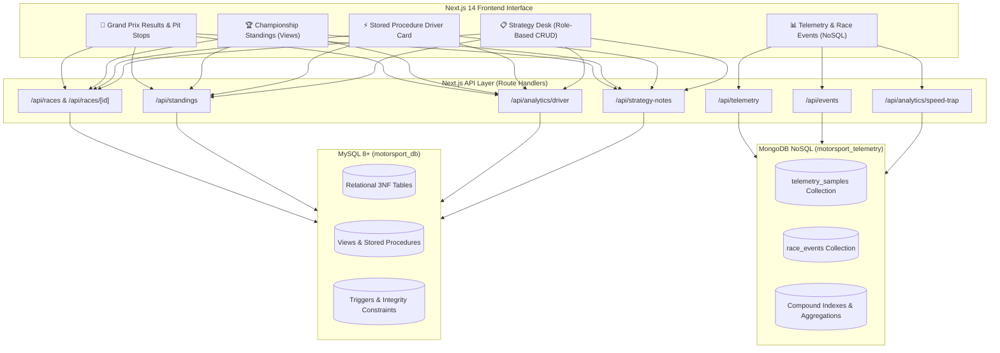

# 🏎️ Motorsport Race Performance and Strategy Management System

> **PES University — UE23CS351A DBMS Experiential Learning (Level 3 Project)**  
> **Team 8**: Full-Stack Multi-Model Database System (**MySQL 8+** Relational + **MongoDB** NoSQL Document Store) built on **Next.js 14** (App Router, TypeScript, Tailwind CSS).

---

## 📌 1. Project Overview & Architecture

Modern Formula 1 racing generates diverse categories of data that cannot be effectively managed with a single database paradigm:
- **Relational Data (MySQL 8+)**: Highly structured, ACID-critical data requiring strict foreign-key integrity, such as 2023 race calendars, championship standings, driver classifications, and millisecond-precision pit stop logs.
- **Document Time-Series Data (MongoDB)**: Unstructured, high-frequency vehicle telemetry sensor samples (~10–50 Hz per lap) and dynamic, semi-structured race control incidents (Safety Cars, Virtual Safety Cars, Red Flags, penalties, investigations).



---

## 👥 2. Team Division of Responsibilities

| Team Member | Database Domain | Responsibilities & Deliverables |
| :--- | :--- | :--- |
| **Student A** | **Relational (MySQL 8+)** | • Relational schema in 3NF (`season`, `circuit`, `team`, `driver`, `race`, `race_result`, `qualifying_result`, `pit_stop`).<br>• Jolpica Ergast F1 ETL data ingestion pipeline.<br>• SQL Views (`view_race_classification`, `view_season_standings`).<br>• Stored Procedure (`sp_get_driver_season_summary`) and Trigger (`trg_validate_pit_stop_duration`).<br>• Core Next.js dashboard shell and MySQL API routes. |
| **Student B** | **NoSQL (MongoDB)** | • MongoDB architecture (`motorsport_telemetry`) with JSON Schema validators.<br>• Two collections: `telemetry_samples` and `race_events`.<br>• Compound indexes for sub-millisecond query optimization.<br>• OpenF1 sensor telemetry ingestion pipeline (`scripts/import_telemetry_data.js`).<br>• MongoDB Aggregation Pipeline (Speed trap leaderboard & stint metrics).<br>• Next.js API route handlers (`/api/telemetry`, `/api/events`, `/api/analytics/speed-trap`).<br>• Interactive SVG Telemetry Trace Comparison Studio & Real-time Incident Feed UI. |

---

## 🛠️ 3. Advanced Database Features (Level 3 Rubric Compliance)

1. **Views (Relational Abstractions)**:
   - `view_race_classification`: Denormalizes race outcomes with circuit, driver, and constructor data.
   - `view_season_standings`: Computes live championship standings from points tallies.
2. **Stored Procedure (`sp_get_driver_season_summary`)**:
   - Encapsulates multi-table analytical aggregations (wins, podiums, best finish, and subquery-calculated average pit stop duration).
3. **Database Trigger (`trg_validate_pit_stop_duration`)**:
   - `BEFORE INSERT` trigger enforcing non-negative pit stop durations via `SIGNAL SQLSTATE '45000'`.
4. **MongoDB Aggregation Pipeline**:
   - Multi-stage pipeline (`$match` ➔ `$group` ➔ `$project` ➔ `$sort`) grouping high-frequency telemetry samples by driver to derive peak velocity, average throttle application %, and DRS activations.
5. **Compound Indexing**:
   - MySQL composite keys on `(season_id, round_no)` and `(race_id, driver_id)`.
   - MongoDB compound index on `{ race_id: 1, driver_id: 1, lap_number: 1 }` for instant lap slice telemetry retrieval.
   - MongoDB compound index on `{ race_id: 1, event_type: 1 }` for incident querying.
6. **Role-Based Access Control (RBAC)**:
   - Enforces distinct permissions: **Race Strategist** (Full CRUD permissions) vs. **Spectator/Viewer** (Read-only access).

---

## 🚀 4. Setup & Execution Guide

### Prerequisites
- Node.js 18+ and npm
- MySQL 8.0+
- MongoDB 6.0+

### Step 1: Clone Repository
```bash
git clone https://github.com/AlphaRay07/DBMS_MiniProject_Team8.git
cd DBMS_MiniProject_Team8
```

### Step 2: Configure Environment Variables
Inside `web-app/`:
```bash
cp web-app/.env.example web-app/.env.local
```
Update credentials:
```env
# MySQL Configuration
MYSQL_HOST=localhost
MYSQL_PORT=3306
MYSQL_USER=root
MYSQL_PASSWORD=your_password
MYSQL_DATABASE=motorsport_db

# MongoDB Configuration
MONGODB_URI=mongodb://localhost:27017/motorsport_telemetry
```

### Step 3: Initialize MySQL Database
```bash
mysql -u root -p < database/mysql/schema.sql
mysql -u root -p motorsport_db < database/mysql/queries.sql
```

### Step 4: Seed Databases
```bash
# Ingest 2023 Season Relational Data
python3 scripts/import_f1_data.py

# Ingest OpenF1 Sensor Telemetry & Race Events (Student B)
node scripts/import_telemetry_data.js
```

### Step 5: Run Next.js Application
```bash
cd web-app
npm install
npm run dev
```
Open **`http://localhost:3000`** in your browser.

---

## 📄 5. Project Reports & Documentation
- **Official Word Report**: [`DBMS_MINI_PROJECT_REPORT_TEAM8.docx`](./DBMS_MINI_PROJECT_REPORT_TEAM8.docx) (Formatted according to PES University template).
- **Relational Schema**: [`database/mysql/schema.sql`](./database/mysql/schema.sql)
- **SQL Analytics & Triggers**: [`database/mysql/queries.sql`](./database/mysql/queries.sql)
- **MongoDB Schema & Validators**: [`database/mongodb/schema.js`](./database/mongodb/schema.js)
- **MongoDB Aggregation Pipelines**: [`database/mongodb/aggregations.js`](./database/mongodb/aggregations.js)
